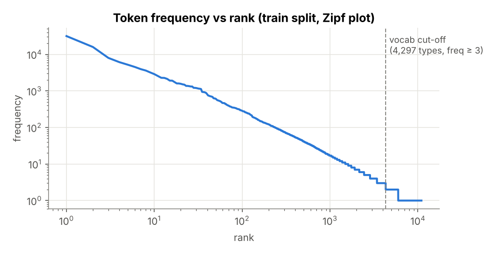
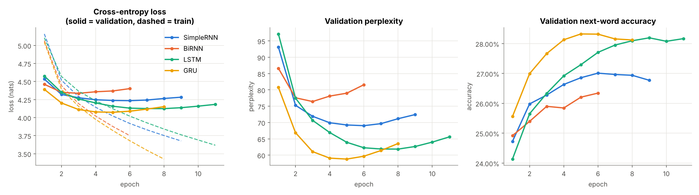
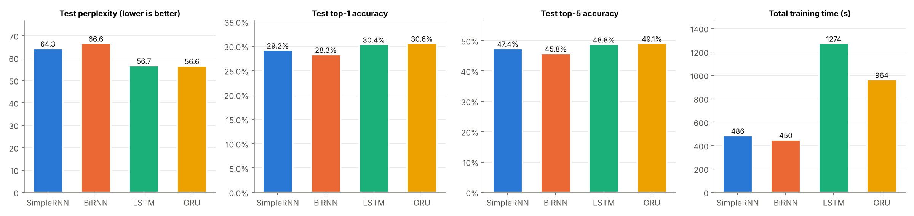
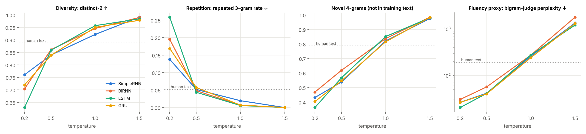

# ShakespeareGen — Autoregressive Text Generation with Simple RNN, Bidirectional RNN, LSTM and GRU

**Foundations of Generative AI (ICT4403) — Assignment 2**

## 1. Problem statement and objective

Given a text corpus, learn a model of $P(w_t \mid w_{t-20}, \dots, w_{t-1})$ — the probability of the next word given
the previous 20 tokens — and use it to generate new text one token at a time, feeding each sampled word back in as input
(autoregressive generation).

Objectives:

1. Prepare a real textual dataset and build input–target sequences for next-word prediction.
2. Implement and train four recurrent architectures — **Simple RNN, Bidirectional RNN, LSTM and GRU** — under identical
   experimental conditions.
3. Compare them with quantitative measures (loss, perplexity, top-1/top-5 accuracy, training time) and qualitative
   properties of their generated text (coherence, diversity, contextual consistency, repetition).
4. Generate text from the same seed sequences at several sampling temperatures, analyse the effect of temperature, and
   identify the most effective model for this dataset.

## 2. Dataset

| | |
|---|---|
| **Name** | Tiny Shakespeare |
| **Source** | Andrej Karpathy, `char-rnn` repository — <https://github.com/karpathy/char-rnn/blob/master/data/tinyshakespeare/input.txt> |
| **Raw file** | <https://raw.githubusercontent.com/karpathy/char-rnn/master/data/tinyshakespeare/input.txt> (a copy is included in `data/`) |
| **Size** | 1,115,394 characters · 40,000 lines · 202,651 whitespace-separated words · 7,940 speeches · 293,562 tokens after tokenisation |
| **Content** | Speeches from several Shakespeare plays (e.g. *Coriolanus*, *Richard II/III*, *Romeo and Juliet*, *Henry VI*, *The Winter's Tale*; the last ~10% is mostly *The Taming of the Shrew*), formatted as a play script: speaker name and colon on one line, then the speech, blank line between speeches. |

**Characteristics relevant to modelling:** Early-Modern English (archaic forms such as *thou, thee, hath, 'tis, o'er*),
a long-tailed (Zipfian) vocabulary, heavy use of punctuation, strict play-script layout, verse lines of roughly ten
syllables, and many proper names that appear only in one play — so the held-out test split is a genuine test of generalisation.



### Preprocessing

1. **Lower-casing** of all text.
2. **Tokenisation** with a regular expression into words (keeping internal apostrophes, e.g. `i'll`, `o'er`),
   punctuation marks (`, . ! ? ; : ' -`) and an explicit line-break token `<nl>`, so the models learn the play layout and
   generated text can be printed in script form.
3. **Vocabulary** built from the training split only; tokens with frequency < 3 → `<unk>`.
4. **Contiguous split** of the token stream: 80% train / 10% validation / 10% test (no overlap between splits).
5. **Input–target construction:** a sliding window of 20 tokens with stride 1; the target is the token immediately after
   the window.

```
input  : w[t-20] … w[t-1]   (20 token ids)
target : w[t]               (1 token id)
```

| Statistic | Value |
|---|---|
| Total tokens | 293,562 |
| Distinct token types | 12,382 |
| Vocabulary (freq ≥ 3, incl. `<unk>`) | 4,297 |
| Train / validation / test tokens | 234,849 / 29,356 / 29,357 |
| Training / validation / test examples (windows) | 234,829 / 29,336 / 29,337 |
| `<unk>` rate (train / test) | 3.6% / 9.8% |

## 3. Models implemented

All four share one skeleton; only the recurrent layer changes.

```
Embedding(V, 128) → recurrent layer (256 units) → Dropout(0.2) → Dense(V, softmax)
```

| Model | Recurrent layer | Notes |
|---|---|---|
| **Simple RNN** | `SimpleRNN(256)` | Plain Elman recurrence $h_t=\tanh(Wx_t+Uh_{t-1}+b)$; fastest, but gradients vanish over long spans. |
| **Bidirectional RNN** | `Bidirectional(SimpleRNN(256))` | Two SimpleRNNs read the 20-token context window forwards and backwards; final states concatenated (512-d). Only the *context* is read both ways — the target word is never seen — so it remains a valid autoregressive model. |
| **LSTM** | `LSTM(256)` | Input/forget/output gates + cell state give an additive memory path for long-range dependencies. |
| **GRU** | `GRU(256)` | Update/reset gates; a lighter gated alternative to the LSTM. |

**Identical training conditions:** same data, vocabulary, window length, splits, embedding size (128), hidden units
(256), dropout (0.2), Adam (lr 1e-3, gradient-norm clipping 1.0), batch size 256, sparse categorical cross-entropy,
up to 20 epochs with early stopping on validation loss (patience 3, best weights restored), fixed random seed (42),
same CPU hardware.

| Model | Trainable parameters |
|---|---:|
| Simple RNN | 1,752,905 |
| Bidirectional RNN | 2,951,497 |
| LSTM | 2,048,585 |
| GRU | 1,950,793 |

## 4. Repository structure

```
rnn-text-generation/
├── rnn_text_generation.ipynb      # full implementation, executed with all outputs
├── requirements.txt
├── data/
│   └── tiny_shakespeare.txt       # dataset copy (downloaded automatically if missing)
├── results/
│   ├── metrics.csv                # test loss, perplexity, accuracy, training time per model
│   ├── generation_metrics.csv     # diversity / repetition / fluency per model × temperature
│   ├── overall_summary.csv
│   ├── generated_samples.md       # every generated sample (4 models × 4 temperatures × 3 seeds)
│   └── history_<Model>.json       # per-epoch training histories and timings
└── plots/
    ├── token_frequency_zipf.png
    ├── training_curves.png
    ├── test_metrics_comparison.png
    └── temperature_effects.png
```

## 5. Execution steps and dependencies

**Dependencies:** Python ≥ 3.10, TensorFlow ≥ 2.16 (Keras 3), NumPy, pandas, Matplotlib, Jupyter
(tested with TensorFlow 2.21 / Python 3.13, CPU only).

```bash
git clone https://github.com/<your-username>/rnn-text-generation-shakespeare.git
cd rnn-text-generation-shakespeare
pip install -r requirements.txt
jupyter notebook rnn_text_generation.ipynb      # then Run All
# or headless:
jupyter nbconvert --to notebook --execute rnn_text_generation.ipynb --inplace --ExecutePreprocessor.timeout=-1
```

The notebook downloads the dataset if `data/tiny_shakespeare.txt` is missing. Training all four models took about
53 minutes on a 2-core CPU (a GPU is much faster). Trained weights are cached in `models/` (git-ignored), so a
second run skips training; delete `models/` to retrain.

## 6. Results obtained





## 7. Model comparison and evaluation

| Model | Params | Test loss | Test perplexity ↓ | Top-1 acc ↑ | Top-5 acc ↑ | Epochs (best) | Time / epoch | Total training time |
|---|---:|---:|---:|---:|---:|---:|---:|---:|
| Unigram baseline (no context) | – | 5.053 | 156.5 | 14.76% | 38.74% | – | – | – |
| Simple RNN | 1.75 M | 4.164 | 64.3 | 29.20% | 47.43% | 9 (6) | 50 s | 486 s |
| Bidirectional RNN | 2.95 M | 4.199 | 66.6 | 28.32% | 45.82% | 6 (3) | 75 s | 450 s |
| LSTM | 2.05 M | 4.038 | 56.7 | 30.39% | 48.79% | 11 (8) | 116 s | 1274 s |
| **GRU** | 1.95 M | **4.035** | **56.6** | **30.61%** | **49.12%** | 8 (5) | 120 s | 964 s |

* **All four models learn real context.** Every network cuts perplexity from 156.5 (unigram) to 57–67 and doubles
  top-1 accuracy (14.8% → 28–31%).
* **Gated models win clearly.** LSTM and GRU reach ≈ 56.6 perplexity, ~12% lower than the Simple RNN (64.3) and
  ~15% lower than the Bidirectional RNN (66.6). Their gates keep useful information from the whole 20-token window,
  whereas the plain RNN's state is dominated by the last few words.
* **GRU vs LSTM is essentially a tie on accuracy** (56.6 vs 56.7 perplexity, 30.6% vs 30.4% top-1 — within run-to-run
  noise), but the GRU has 5% fewer parameters, reaches its best validation loss after 5 epochs instead of 8, and needed
  **24% less total training time** (964 s vs 1274 s). Per epoch the two cost about the same on this CPU.
* **Bidirectionality does not help next-word prediction.** Despite having the most parameters, the BiRNN is the worst
  model. Reading the context window backwards adds no information about the *next* word (the most predictive tokens
  are the most recent ones, which the forward pass already sees last) but adds 1.2 M parameters, so the model overfits
  fastest — validation loss is lowest at epoch 3 and rises afterwards. It is also the slowest Simple-RNN variant per epoch
  (75 s vs 50 s). Note also that a bidirectional model cannot reuse its state incrementally during generation: the whole
  window must be re-read backwards for every new token.
* **Overfitting is the limiting factor for all models.** The training curves show training loss falling steadily while
  validation loss turns upward after 3–8 epochs; ~235 k training tokens is small for 2 M-parameter models, so early
  stopping with best-weight restoration is essential.
* **The test split measures generalisation to unseen text:** it is mostly a play not present in training (*The Taming
  of the Shrew*), so 9.8% of its tokens are `<unk>` (3.6% in training) and its character names are unknown to the models.
  Because `<unk>` is a single shared class it is comparatively easy to predict, so the absolute perplexities should only
  be compared within this study, not with other papers.

## 8. Sampling-temperature analysis

Text was generated autoregressively for 60 tokens from the **same three 20-token seeds** (taken from the unseen test
split) with every model at **T = 0.2, 0.5, 1.0 and 1.5** (`<unk>` masked during sampling). For each model × temperature,
15 continuations were scored with: distinct-2 (diversity), repeated-3-gram rate (repetition), novel-4-gram rate
(share of 4-grams not in the training text — copying vs. invention) and the perplexity under an independent add-k
bigram model fitted on the training text (a fluency/coherence proxy that none of the networks influences).
All samples: [`results/generated_samples.md`](results/generated_samples.md).



Averages over 15 continuations (3 seeds × 5 samples, 60 tokens each). "Human" = real 60-token continuations from the test text.

| T | distinct-2 ↑ | repeated 3-grams ↓ | novel 4-grams | bigram-judge perplexity ↓ |
|---|---|---|---|---|
| 0.2 | 0.63 – 0.76 | 0.14 – 0.26 | 0.36 – 0.47 | 20 – 30 |
| 0.5 | 0.84 – 0.86 | 0.04 – 0.06 | 0.54 – 0.62 | 40 – 57 |
| 1.0 | 0.92 – 0.96 | 0.01 – 0.02 | 0.82 – 0.85 | 242 – 276 |
| 1.5 | 0.98 – 0.99 | 0.00 | 0.98 | 1216 – 1795 |
| *Human text* | *0.89* | *0.05* | *0.79* | *194* |

* **Low temperature (T = 0.2) — coherent locally, but repetitive and generic.** Sampling is almost greedy, so every model
  falls into high-frequency loops: *"my lord, my lord, my lord"*, *"and i will not … and i will not"*,
  *"the king of york, … the duke of york"*. Repeated-3-gram rates (0.14–0.26) are 3–5× higher than in real text and
  diversity is the lowest. The very low judge perplexity (20–30, far below human 194) shows the text is *too* predictable
  — safe, common word transitions rather than Shakespearean variety. The LSTM is the most repetitive here (0.26).
* **Moderate temperature (T = 0.5) — the most readable output.** Repetition drops to human level (≈ 0.05), the play
  format is respected (speaker tag → colon → new line → speech), lines are mostly grammatical
  (*"and, if thou wilt not speak to me, / and i am so, and i be bound to fight"* — LSTM), but content is still somewhat
  bland and diversity slightly below human text.
* **T = 1.0 — closest to real-text statistics, less coherent.** Diversity (0.92–0.96) and novelty (0.82–0.85) are just
  above human values and repetition disappears. Vocabulary becomes rich and archaic (*"fair saint of all"*, *"a prosperous
  youth"*), but grammar breaks more often and sentences lose their thread after a few words.
* **High temperature (T = 1.5) — diverse but incoherent.** Almost every 4-gram is new, repetition is zero, and the judge
  perplexity explodes (> 1200): word salad such as *"knees in encounter by men richard's power! before with him receive the
  better scene"*. Speaker tags largely disappear, i.e. the models lose the document structure.
* **Trade-off.** Increasing temperature monotonically trades coherence for diversity: repetition ↓, diversity ↑,
  novelty ↑, fluency ↓. For this dataset **T ≈ 0.5–0.7** gives the best balance of readable, non-repetitive text;
  **T = 1.0** matches the diversity of real Shakespeare but at a clear cost in coherence.

**Example — the same seed, GRU, four temperatures**

Seed: *"widow: / lord, let me never have a cause to sigh, / till i be brought to"*

| T | GRU continuation (first lines) |
|---|---|
| 0.2 | `- night, and i am not / to - night. / polixenes: / well, sir, i beseech you, sir. / menenius: / i am not, sir, / i warrant you, sir.` |
| 0.5 | `see my wife, but you, / and all my soul will be this of my joys. / duke of york: / where is you that, my lord?` |
| 1.0 | `rich my body., / they may that deadly remain on yourselves, / and clarence ignoble within a traitor bold.` |
| 1.5 | `add truth as death rob means my worse, both lies. she am worth / against threes some senators of wait hour to appear? speak` |

**Model differences in generation.** At T = 0.5 the GRU (judge perplexity 40.2) and LSTM (40.9) produce the most fluent
text, the Simple RNN is close (41.5) and the BiRNN is clearly worst (56.7), mirroring the test-perplexity ranking. At
T = 1.0 the GRU has the lowest judge perplexity (242, closest to the human 194) — it stays more fluent than the other
models while being equally diverse. The gated models also hold the speaker/speech structure better over 60 tokens.

**Contextual consistency.** None of the models carries the seed's specific context forward for long: with a 20-token
window and seeds from an unseen play (characters such as Vincentio or the Widow are `<unk>` to the models), all
continuations drift back to the characters and themes of the training plays (Richard, York, Norfolk, Romeo, Menenius).
Topic consistency holds for roughly one line; style, register and layout are maintained much longer.

## 9. Conclusion — best-performing model

**The GRU is the most effective autoregressive generator for Tiny Shakespeare.** It achieves the lowest test perplexity
(56.6) and the highest top-1 (30.6%) and top-5 (49.1%) accuracy, produces the most fluent text at both T = 0.5 and
T = 1.0, and trains 24% faster than the LSTM with fewer parameters. The LSTM is a very close second in accuracy (the
difference is within the noise of a single run) but costs more training time. The Simple RNN is fast but measurably
weaker, and the Bidirectional RNN is the least suitable: bidirectional reading of the context gives no benefit for
predicting the next word and only adds parameters and overfitting. For generation, a temperature around 0.5–0.7 gives
the best balance between coherence and diversity.

**Limitations and possible improvements:** single training run per model (no seed averaging); a 20-token window limits
long-range consistency; stronger regularisation (higher dropout, weight tying between embedding and output layer),
stacked recurrent layers, or top-k / nucleus sampling would likely improve generation quality further.
